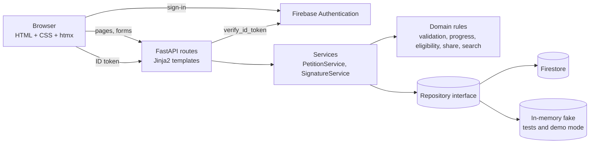
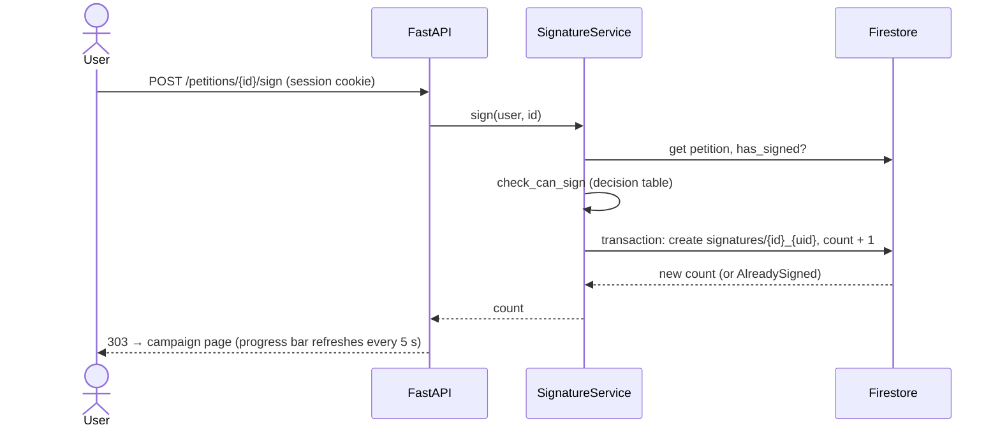

<!--
  Living draft of the CEN317 interim report. It mirrors the official template section by section.
  Before submission: copy into the Word template, apply its formatting, export to PDF.
  Items marked TODO need team input; references marked (verify) must be checked before submission.
-->

> **Last updated:** 24 October 2026 — T1.1–T1.5, T2.1, T2.4 and T2.7 completed; Firebase project set up.

<div align="center">

ÇUKUROVA UNIVERSITY
FACULTY OF ENGINEERING
DEPARTMENT OF COMPUTER ENGINEERING

**CEN317 ENGINEERING DESIGN**
**INTERIM REPORT**

**DESIGN AND IMPLEMENTATION OF A VERIFIED ONLINE PETITION PLATFORM**
<!-- TODO: replace with the final project name -->

STUDENT NUMBER – NAME <!-- TODO -->
STUDENT NUMBER – NAME <!-- TODO -->
STUDENT NUMBER – NAME <!-- TODO -->

NOVEMBER 2026
ADANA

</div>

---

## INTERIM REPORT ABSTRACT

Online petition platforms let citizens and members of an organisation turn an individual complaint into visible
collective support. Their credibility, however, depends on whether the displayed signature count can be trusted:
when one person can sign many times, the count loses its meaning. This project designs and implements a web-based
petition platform on which users can start a campaign for a social or institutional problem, collect signatures, follow
the progress towards a signature goal through a live progress bar, and share the campaign on social media.
Duplicate signatures are prevented by requiring every signer to hold an account whose e-mail address or phone number
has been verified through Firebase Authentication, and by enforcing a single signature per account and campaign at the
database level.

The system follows a server-rendered architecture: a Python FastAPI application renders Jinja2 HTML templates, htmx
refreshes the progress bar without hand-written JavaScript, and Google Firestore stores campaigns and signatures. The
design separates pure domain rules, repositories, services and web routes so that every rule can be tested in
isolation. Development follows test-driven development (TDD) with a "contract-first" approach adapted from the
CEN315 Introduction to Test Engineering course: the complete test suite of a phase is written before the
implementation, unfinished tasks are marked as strict expected failures, and a GitHub Actions pipeline runs static
analysis, the test suite and branch-coverage measurement on every pull request. Test cases are derived with equivalence
partitioning, boundary value analysis, decision tables and MC/DC-style condition analysis, and are prioritised with a
risk-based (likelihood × impact × detectability) assessment.

At the time of writing, the architecture, the project skeleton, the continuous integration pipeline, the domain
rules (user verification, form validation, progress percentage, Turkish-aware search and signature eligibility), the
in-memory repository and the Firebase sign-in (server-side token verification and an e-mail/SMS sign-in page) are
complete; 113 of the 183 tests pass and the remaining 70 belong to tasks still in progress.
<!-- TODO: update with Phase 2 results before submission --> The remaining work covers the campaign and signature
services and pages, the Firestore repository, deployment, mutation testing, end-to-end tests and a user acceptance
test with fellow students.

**Keywords:** online petition, duplicate signature prevention, Firebase Authentication, FastAPI, test-driven development

---

## CONTENTS

| Section | Page |
|---|---|
| INTERIM REPORT ABSTRACT | i |
| CONTENTS | ii |
| ABBREVIATIONS AND SYMBOLS | iii |
| LIST OF TABLES | iv |
| LIST OF FIGURES | v |
| 1. PROJECT INTRODUCTION | 1 |
| 2. RELEVANT STUDIES AND LITERATURE REVIEW | 3 |
| 3. PROJECT MATERIALS | 5 |
| 4. CURRENT STATE OF THE PROJECT | 7 |
| 5. FUTURE IMPROVEMENTS FOR THE PROJECT | 9 |
| ACKNOWLEDGEMENTS | 11 |
| REFERENCES | 13 |
| ABOUT THE AUTHORS AND AUTHOR CONTRIBUTIONS | 15 |
| APPENDICES | 17 |

<!-- Page numbers are set in the Word template. -->

## ABBREVIATIONS AND SYMBOLS

| Abbreviation | Meaning |
|---|---|
| API | Application Programming Interface |
| BVA | Boundary Value Analysis |
| CI | Continuous Integration |
| EP | Equivalence Partitioning |
| E2E | End-to-End (testing) |
| HTML | HyperText Markup Language |
| ID | Identifier |
| KVKK | Kişisel Verilerin Korunması Kanunu – Turkish Personal Data Protection Law |
| MC/DC | Modified Condition/Decision Coverage |
| OG | Open Graph (link preview metadata) |
| RPN | Risk Priority Number |
| SMS | Short Message Service |
| TDD | Test-Driven Development |
| UAT | User Acceptance Testing |
| XSS | Cross-Site Scripting |

## LIST OF TABLES

| Table | Page |
|---|---|
| Table 2.1. Comparison of existing petition platforms | 3 |
| Table 3.1. Technologies and tools | 5 |
| Table 3.2. Functional requirements | 5 |
| Table 3.3. Decision table for signature eligibility | 6 |
| Table 3.4. Risk-based test prioritisation | 6 |
| Table 4.1. Task status of the contract test suite | 7 |

## LIST OF FIGURES

| Figure | Page |
|---|---|
| Figure 3.1. System architecture | 5 |
| Figure 3.2. Signing sequence | 6 |
| Figure 4.1. Home page (screenshot) | 7 | <!-- TODO -->
| Figure 4.2. CI run summary (screenshot) | 8 | <!-- TODO -->

---

## 1. PROJECT INTRODUCTION

Petitions are one of the oldest instruments of civic participation: a group of people expresses a shared demand and
the number of signatures signals how widely that demand is supported. Moving petitions online has lowered the cost of
both starting and signing a campaign. Global platforms such as Change.org and Avaaz host campaigns on every scale,
and some parliaments run official e-petition systems in which reaching a signature threshold triggers a formal
response (UK Parliament, n.d.). The same mechanism is useful inside institutions: students of a university, for
example, can collect support for a new bicycle lane or longer library hours before taking the request to the
administration.

The value of an online petition rests on the signature count. If a single person can sign repeatedly, or if automated
accounts can sign, the number no longer reflects real support. Existing platforms address this to different degrees,
from accepting a name and an e-mail address without confirmation to requiring a verified account (see Section 2).
Research on e-petition systems also shows that early visibility and sharing strongly influence whether a campaign
gains momentum (Hale et al., 2013), which makes live progress feedback and easy sharing important design goals.

This project designs and implements a petition platform with three mandatory capabilities defined in the project
assignment: (1) a verification mechanism based on e-mail or phone identity that prevents duplicate signatures,
(2) a live progress bar that visualises the number of collected signatures against the campaign goal, and
(3) social media sharing integrations. The scope covers campaign creation, listing, search, a campaign page,
signing, and the related security measures. Payment, moderation workflows and native mobile applications are out of
scope.

Beyond the product itself, the project is used to apply software test engineering practice from the first day:
the development process is test-driven, test cases are designed with systematic techniques, and quality is measured
with automated coverage and, later, mutation analysis.

The rest of this report is organised as follows. Section 2 reviews existing petition platforms and related studies.
Section 3 describes the requirements, architecture, technologies and test strategy. Section 4 presents the current
state of the implementation, and Section 5 lists the work planned until the final presentation.

---

## 2. RELEVANT STUDIES AND LITERATURE REVIEW

**Commercial and non-profit platforms.** Change.org, founded in 2007, is one of the largest general-purpose petition
sites; anyone can start a campaign, and signers provide a name and an e-mail address. Avaaz, also founded in 2007,
runs campaigns on global issues with a similar sign-with-e-mail model. Both platforms emphasise sharing: after
signing, users are prompted to share the campaign on social networks.

**Official e-petition systems.** The UK Parliament petitions site requires signers to confirm their e-mail address
and to state that they are a British citizen or UK resident; petitions receive a government response at 10,000
signatures and are considered for a parliamentary debate at 100,000 signatures (UK Parliament, n.d.). The White
House "We the People" system (2011–2021) used similar thresholds. In Türkiye, citizens can submit individual
applications to public institutions through channels such as CİMER, but these are individual complaints rather than
public signature campaigns, which leaves room for a campaign-oriented platform for institutional use.

**Research on e-petitions.** Hale, Margetts and Yasseri (2013) analysed petitions on the UK No. 10 Downing Street
website and found that most petitions fail to reach their thresholds and that the signatures gathered in the first
day largely determine success. Margetts et al. (2016) describe online collective action as "turbulent": many small
acts of participation (signing, sharing) occasionally cascade into large mobilisations. Wright (2016) discusses how
the success of e-petitions should be judged beyond reaching a threshold. These findings motivate the live progress
bar and the sharing features of this project.

**Identity and duplicate prevention.** Approaches range from no verification, through e-mail confirmation links,
to phone (SMS) verification and national identity checks. E-mail and phone verification are inexpensive and widely
supported by authentication services such as Firebase Authentication (Google, n.d.). National identity numbers give
stronger guarantees but are personal data whose processing is regulated in Türkiye by Law No. 6698 on the Protection
of Personal Data (KVKK, 2016); this project therefore does not collect them (see Section 3.2).

**Test-driven development and test design.** TDD, popularised by Beck (2003), writes a failing test before the
code that makes it pass and then refactors. Test-design techniques such as equivalence partitioning, boundary value
analysis, decision tables and coverage criteria are described by Ammann and Offutt (2016); test doubles (fakes,
stubs, mocks, spies) follow the terminology of Meszaros (2007). Inozemtseva and Holmes (2014) showed that code coverage
alone is not strongly correlated with test-suite effectiveness, which is why this project plans to complement coverage
with mutation testing (DeMillo et al., 1978).

**Table 2.1.** Comparison of existing petition platforms.

| Platform | Signer verification | Live progress | Sharing | Institutional use |
|---|---|---|---|---|
| Change.org | E-mail (name + e-mail) | Count and goal | Built-in | Possible, not targeted |
| Avaaz | E-mail | Count and goal | Built-in | No |
| UK Parliament petitions | Confirmed e-mail + residency declaration | Count, thresholds | Links | No (national) |
| **This project** | **Verified e-mail or phone (SMS), one signature per account** | **Auto-refreshing bar** | **5 platforms + Open Graph** | **Yes** |

<!-- TODO (team): add 1–2 more related projects or academic studies and verify the facts above before submission. -->

---

## 3. PROJECT MATERIALS

### 3.1. Requirements

**Table 3.2.** Functional requirements (summary; full list with traceability in `docs/TEST_STRATEGY.md`).

| ID | Requirement |
|---|---|
| FR-1 | A signed-in user creates a campaign with a title (10–150 characters), a description (50–5000) and a goal (10–1,000,000 signatures). |
| FR-2 | Campaigns are listed from newest to oldest. |
| FR-3 | Search ignores case and Turkish diacritics ("kampus" finds "Kampüs"). |
| FR-4 | The campaign page shows title, description, signature count, progress bar and share links. |
| FR-5 | Users sign in with e-mail (with a verification e-mail) or with a phone number (SMS code). |
| FR-6 | Only users with a verified e-mail **or** phone can sign. |
| FR-7 | A user signs a campaign at most once, even under concurrent requests. |
| FR-8 | The progress percentage is rounded down, capped at 100 %, and refreshes within 5 seconds. |
| FR-9 | Share links for X, Facebook, WhatsApp, LinkedIn and Telegram plus Open Graph metadata are generated. |

Non-functional priorities were set with the ISO/IEC 25010 quality model: functional suitability and security are
rated high, reliability, usability and maintainability medium, performance and portability low.

### 3.2. Architecture and Technologies

The application is server-rendered (Figure 3.1). The browser receives ready HTML pages; the only client-side
JavaScript is the Firebase sign-in script, because phone verification with reCAPTCHA must run in the browser.

**Figure 3.1.** System architecture.



**Table 3.1.** Technologies and tools.

| Purpose | Technology | Reason |
|---|---|---|
| Language | Python 3.12+ | Known by the whole team |
| Web framework | FastAPI | Form/JSON handling, built-in test client |
| Templates | Jinja2 | Server-side HTML with automatic escaping (XSS protection) |
| Live updates | htmx | Periodic partial refresh without writing JavaScript |
| Authentication | Firebase Authentication | E-mail verification and SMS verification as a service |
| Database | Google Firestore | Managed, free tier, transactions for unique signatures |
| Testing | pytest, pytest-cov, FastAPI TestClient, unittest.mock | Unit/integration tests, branch coverage, test doubles |
| Static analysis | ruff | Style and bug-pattern checks |
| CI | GitHub Actions | Runs checks on every pull request and every push to `main` |
| Hosting | Render | Free Python hosting (GitHub Pages cannot run server code) |

**Key design decisions** (full list in `docs/DECISIONS.md`):

- *Dependency injection for testability.* `create_app(settings, repo, verifier, clock)` receives its dependencies,
  so tests replace Firestore, Firebase and the system clock with an in-memory fake, a stub and a fixed clock.
- *Duplicate prevention at two levels.* A pure decision function (Table 3.3) rejects ineligible requests, and the
  database stores each signature under the key `{petition_id}_{uid}` inside a transaction that also increments the
  counter, so even two simultaneous requests cannot create two signatures (Figure 3.2).
- *Trust only the server.* The browser sends a Firebase ID token; the server verifies it with the Firebase Admin SDK
  and stores the user in a signed session cookie. User identifiers are never taken from form fields.
- *Verified e-mail OR phone.* Requiring both would increase SMS cost and user friction; collecting national identity
  numbers was rejected for privacy reasons (KVKK). The remaining risk that one person opens two accounts is documented
  as an accepted residual risk (Table 3.4, R3).

**Figure 3.2.** Signing sequence.



### 3.3. Test Strategy

The test strategy applies the CEN315 course content (details in `docs/TEST_STRATEGY.md`).

#### 3.3.1. Contract-first TDD workflow

Before a phase starts, its complete test suite is written. The tests define the files, class and function names,
signatures and expected behaviour, i.e. they act as an executable specification. Every test file for an
unimplemented task begins with a strict expected-failure marker. The CI pipeline therefore stays green while
reporting progress ("25 passed, 151 xfailed"). A developer removes the marker (red), writes the simplest code that
passes (green) and refactors. Because the marker is strict, a finished task whose marker was not removed fails the
build, so progress cannot silently be left untracked. Each new test suite is validated against a throw-away reference
solution before it is committed, ensuring that the tests are consistent and achievable.

#### 3.3.2. Test design techniques

- **Equivalence partitioning and boundary value analysis** for form validation (e.g. goal: −5, 0, 9, 10, 11,
  999,999, 1,000,000, 1,000,001) and for the progress percentage (99/100 → 99 %, 100/100 → 100 %, 150/100 → 100 %).
- **Decision table** for signature eligibility (Table 3.3), including rows that verify rule priority.
- **Condition analysis (MC/DC style)** for `is_verified = (email AND email_verified) OR phone`.
- **Loop coverage** (zero, one, many records and the limit) for listing and search.

**Table 3.3.** Decision table for signature eligibility.

| Rule | Signed in | Campaign | Verified | Signed before | Result |
|---|---|---|---|---|---|
| R1 | no | – | – | – | Not logged in |
| R2 | yes | closed | – | – | Campaign closed |
| R3 | yes | open | no | – | Not verified |
| R4 | yes | open | yes | yes | Already signed |
| R5 | yes | open | yes | no | Allowed |

#### 3.3.3. Test levels and test doubles

The suite follows the test pyramid: unit tests for domain rules and services (currently 138), integration tests
through the FastAPI test client (45), and a small number of browser end-to-end tests planned for Phase 3. The
in-memory repository is used as a *fake*, the token verifier as a *stub*, `unittest.mock.Mock` as a *mock* of the
Firebase Admin SDK and as a *spy* that records repository calls, and a fixed clock removes time-dependent flakiness.
A race condition between two simultaneous signatures is simulated by injecting an `AlreadySignedError` into the
repository.

#### 3.3.4. Risk-based prioritisation

Risks were scored with RPN = likelihood × impact × detectability (1–5 each); high-RPN risks receive the deepest tests.

**Table 3.4.** Risk-based test prioritisation (excerpt).

| Risk | L | I | D | RPN | Mitigation / tests |
|---|---|---|---|---|---|
| One person signs twice using two accounts (e-mail and phone) | 3 | 3 | 5 | 45 | Accepted residual risk, documented |
| Forged or expired token | 2 | 5 | 4 | 40 | Server-side verification; mocked failure tests |
| XSS in campaign text | 3 | 4 | 3 | 36 | Template auto-escaping; XSS integration test |
| Concurrent signatures break uniqueness/counter | 2 | 4 | 4 | 32 | Transaction + unique key; race-condition test |
| Duplicate signature with the same account | 3 | 5 | 2 | 30 | Decision table, repository and page tests |

#### 3.3.5. Continuous integration and quality measurement

On every pull request and every push to `main` GitHub Actions installs the dependencies, runs ruff (static analysis and formatting),
runs the test suite with branch coverage, publishes a task-status table on the run summary page and uploads an HTML
coverage report. Branch coverage of the domain and service layers is targeted at 85 % or more; because coverage only
measures reachability, mutation testing with mutmut will be added in Phase 3 to measure whether the assertions detect
injected faults.

---

## 4. CURRENT STATE OF THE PROJECT

*Status on 24 October 2026 (Phase 2 in progress).*

The following parts are complete:

- **Project skeleton.** The original Flask prototype (navigation bar and placeholder routes) was migrated to FastAPI.
  The application factory, configuration loading, session handling, sign-in/sign-out endpoints, error pages, base
  templates and styling are in place. Without Firebase credentials the application runs in a *demo mode* with an
  in-memory database and predefined demo users, so it can be run on any computer immediately.
- **Contract test suite for Phases 1 and 2.** 183 tests define the behaviour of thirteen tasks (Table 4.1); every
  suite was verified against a reference solution before it was added. 113 tests pass and 70 tests belong to tasks
  that are not finished yet.
- **Domain rules.** The user verification rule (T1.1, tested with condition/MC/DC cases), campaign form validation
  (T1.2, equivalence partitioning and boundary values), the progress percentage (T1.3, rounded down and capped at
  100 %), Turkish-aware search normalisation (T1.4, e.g. "İ"/"I" and "ü"/"u") and the signature eligibility decision
  table (T2.1). Branch coverage of these modules is 100 %.
- **In-memory repository (T1.5).** Used as a *fake* in the tests and as the database of the demo mode. It rejects a
  second signature of the same account on the same campaign, which mirrors the rule the Firestore repository will
  enforce with a transaction.
- **Firebase integration.** A Firebase project was created on the free Spark plan (Firestore in `europe-west1`,
  e-mail/password and phone providers, test phone numbers for development). Team members are added as editors and
  each downloads a personal service-account key that never enters the repository. The server verifies Firebase ID
  tokens (T2.4, tested with a mock of the Firebase SDK), and the sign-in page (T2.7) supports e-mail with a
  verification e-mail and SMS codes; an unverified e-mail address cannot open a session.
- **Continuous integration.** The pipeline described in Section 3.3.5 runs on every pull request.
- **Documentation.** README with installation and a step-by-step development guide for team members who work
  without an AI assistant, project plan with deadlines, test strategy, architecture decision records.

**Table 4.1.** Task status of the contract test suite.

| Task | Description | Status |
|---|---|---|
| T1.1 | User verification rule | Done |
| T1.2 | Form validation (EP/BVA) | Done |
| T1.3 | Progress percentage | Done |
| T1.4 | Turkish-aware search | Done |
| T1.5 | In-memory repository | Done |
| T1.6 | Campaign service | Pending |
| T1.7 | Campaign pages | Pending |
| T2.1 | Signature eligibility (decision table) | Done |
| T2.2 | Signature service | Pending |
| T2.3 | Share links | Pending |
| T2.4 | Firebase token verification | Done |
| T2.5 | Signing page, live progress, sharing | Pending |
| T2.7 | Firebase sign-in page (e-mail + SMS) | Done |

Phase 1 ended on 23 October with the campaign service and pages (T1.6, T1.7) still open; they are being finished
together with the remaining Phase 2 tasks before the interim report.

<!-- TODO: Figure 4.1 home page screenshot, Figure 4.2 CI summary screenshot, coverage figures. -->

Source code excerpts are given in Appendix A and the folder structure in Appendix C.

---

## 5. FUTURE IMPROVEMENTS FOR THE PROJECT

| Period | Planned work |
|---|---|
| 24 Oct – 1 Nov 2026 | Campaign service and pages, page design, signature service, share links, signing page with the live progress bar, Firestore repository; manual end-to-end check with real Firebase accounts |
| 10 Nov – 6 Dec 2026 (after the midterm week) | Instructor feedback; quality and release work (campaign closing by its owner, coverage gate, mutation testing, Firestore emulator and end-to-end tests, deployment to Render, dependency scanning, accessibility review); user acceptance test with at least five students; final report and presentation. A detailed plan will be made after the midterms. |

Possible extensions if time allows: linking e-mail and phone identities to reduce the two-account risk, campaign
categories and images, signer comments, and an administrator moderation page.

---

## ACKNOWLEDGEMENTS

<!-- TODO (team): advisor and course instructors; state that no external funding (BAP, TÜBİTAK) was received, if so. -->

---

## REFERENCES

Ammann, P., & Offutt, J. (2016). *Introduction to software testing* (2nd ed.). Cambridge University Press.

Beck, K. (2003). *Test-driven development: By example*. Addison-Wesley.

DeMillo, R. A., Lipton, R. J., & Sayward, F. G. (1978). Hints on test data selection: Help for the practicing
programmer. *Computer, 11*(4), 34–41. (verify pages)

Google. (n.d.). *Firebase Authentication*. Retrieved October 13, 2026, from https://firebase.google.com/docs/auth

Hale, S. A., Margetts, H., & Yasseri, T. (2013). Petition growth and success rates on the UK No. 10 Downing Street
website. In *Proceedings of the 5th Annual ACM Web Science Conference* (pp. 132–138). ACM. (verify)

Inozemtseva, L., & Holmes, R. (2014). Coverage is not strongly correlated with test suite effectiveness. In
*Proceedings of the 36th International Conference on Software Engineering* (pp. 435–445). ACM. (verify pages)

ISO/IEC. (2011). *Systems and software engineering — Systems and software Quality Requirements and Evaluation
(SQuaRE) — System and software quality models* (ISO/IEC 25010:2011).

Kişisel Verilerin Korunması Kanunu [Law on the Protection of Personal Data], Law No. 6698. (2016). *Resmî Gazete*,
29677.

Margetts, H., John, P., Hale, S., & Yasseri, T. (2016). *Political turbulence: How social media shape collective
action*. Princeton University Press.

Meszaros, G. (2007). *xUnit test patterns: Refactoring test code*. Addison-Wesley.

UK Parliament. (n.d.). *Petitions: UK Government and Parliament*. Retrieved October 13, 2026, from
https://petition.parliament.uk/help

Wright, S. (2016). 'Success' and online political participation: The case of Downing Street e-petitions.
*Information, Communication & Society, 19*(6), 843–857. (verify)

---

## ABOUT THE AUTHORS AND AUTHOR CONTRIBUTIONS

<!-- TODO (team): each author writes one paragraph: academic background, role, tasks performed (use the team's task
     sheet and the git history), special responsibilities. -->

**STUDENT NAME (Student No.)** — …

**STUDENT NAME (Student No.)** — …

**STUDENT NAME (Student No.)** — …

---

## APPENDICES

### Appendix A: Source Code

<!-- In the PDF, paste code with a code-formatting tool into borderless single-cell tables, one table per file. -->
Files to include (final selection after Phase 2): `app/domain/eligibility.py`, `app/domain/progress.py`,
`app/services/signature_service.py`, `app/repositories/firestore.py`, `app/routes/pages.py`,
`tests/unit/test_eligibility.py`, `tests/unit/test_validation.py`, `.github/workflows/ci.yml`.

### Appendix B: Additional Figures

<!-- TODO: screenshots of every page, the CI summary table and the HTML coverage report. -->

### Appendix C: Folder Structure

```
petition-system
->app
  ->main.py, config.py, clock.py
  ->domain        (models.py, errors.py, validation.py, progress.py, search.py, eligibility.py, share.py)
  ->repositories  (base.py, memory.py, firestore.py)
  ->services      (petition_service.py, signature_service.py)
  ->auth          (verifier.py, demo.py)
  ->routes        (pages.py, auth.py, deps.py)
  ->templates     (base.html, home.html, login.html, search.html, 404.html, petitions/, partials/)
  ->static        (css/style.css, js/auth.js)
->tests
  ->unit          (11 test modules)
  ->integration   (4 test modules)
  ->helpers.py, conftest.py
->scripts/check.py
->docs            (PROJECT_PLAN.md, TEST_STRATEGY.md, DECISIONS.md, report/INTERIM_REPORT.md)
->.github/workflows/ci.yml
->README.md, AGENTS.md, pyproject.toml, requirements.txt, requirements-dev.txt, .env.example
```
